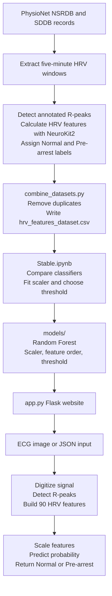

<div align="center">

# Pre-Cardiac Arrest Prediction

**ECG-derived HRV analysis with a local Flask prediction website**

The original pipeline extracts HRV features from annotated ECG records, trains a Random Forest classifier, and predicts whether an input is `Normal` or `Pre-arrest`.

</div>

> **Important**
>
> This is a research and demonstration system, not a medical device. Its output must not be used for diagnosis or emergency decision-making.

## Contents

- [Architecture](#architecture)
- [Repository Layout](#repository-layout)
- [Installation](#installation)
- [Dataset Preparation](#dataset-preparation)
- [HRV Features](#hrv-features)
- [Training](#training)
- [Run The Website](#run-the-website)
- [JSON API](#json-api)
- [Limitations](#limitations)

## Architecture



## Repository Layout

```text
.
|-- app.py                          # Original Flask application
|-- requirements.txt                # Python dependencies
|-- templates/index.html            # Website interface
|-- src/
|   |-- image_to_signal.py          # ECG plot image digitizer
|   `-- raw_to_hrv_features.py      # HRV extraction and prediction helpers
|-- scripts/
|   |-- extract_nsrdb.py            # NSRDB feature extraction
|   |-- extract_sddb.py             # SDDB feature extraction
|   `-- combine_datasets.py         # Dataset combination
|-- data/
|   |-- raw/                        # Generated feature caches
|   `-- processed/                  # Combined training dataset
|-- models/                         # Saved model artifacts
|-- notebooks/Stable.ipynb          # Stable training and evaluation notebook
`-- TestImages/                     # Local image samples, when available
```

## Installation

From the repository root:

```bash
python3 -m venv venv
source venv/bin/activate
python -m pip install --upgrade pip
python -m pip install -r requirements.txt
```

On Windows:

```powershell
python -m venv venv
venv\Scripts\activate
python -m pip install -r requirements.txt
```

The project uses packages including Flask, NeuroKit2, WFDB, NumPy, pandas, scikit-learn, joblib, Pillow, and matplotlib. Use the virtual environment when running the project so the installed dependencies are available.

## Dataset Preparation

The original extraction scripts download and read the annotated records through WFDB and PhysioNet.

### Extract NSRDB Features

```bash
python scripts/extract_nsrdb.py
```

This writes `data/raw/nsrdb_features_cache.csv`. The script:

- uses five-minute HRV windows with a one-minute step
- keeps windows containing at least 150 beats
- labels NSRDB windows as normal (`label = 0`)
- subsamples the long normal recordings to reduce their dominance in the dataset

### Extract SDDB Features

```bash
python scripts/extract_sddb.py
```

This writes `data/raw/sddb_features_cache.csv`. SDDB windows are labeled as follows:

- pre-arrest (`label = 1`) when the window ends within 30 minutes of the recording end
- normal (`label = 0`) when the window ends at least 60 minutes before the recording end
- discarded when they fall in the ambiguous 30-to-60-minute buffer

The SDDB extraction also uses five-minute windows and requires at least 150 beats per window.

### Combine The Feature Caches

After both extraction commands finish:

```bash
python scripts/combine_datasets.py
```

The combined, de-duplicated dataset is written to:

```text
data/processed/hrv_features_dataset.csv
```

The extraction scripts access PhysioNet, so internet access is required when the records are not already available in the local WFDB cache.

## HRV Features

`src/raw_to_hrv_features.py` produces the exact 90-column feature vector expected by the saved model. The feature list and ordering are loaded from `models/feature_columns.json`.

Features are generated from R-peak locations using `neurokit2.hrv`. The pipeline includes time-domain, frequency-domain, and nonlinear HRV measurements. The main inputs are:

- R-peak sample positions and a sampling rate, or
- a raw ECG signal and a sampling rate, from which R-peaks are detected automatically

At least 150 detected beats are required for the old model's HRV calculation. Short or irregular recordings can be rejected when NeuroKit2 cannot calculate all expected columns.

## Training

Open the stable training notebook:

```bash
jupyter notebook notebooks/Stable.ipynb
```

The notebook uses the combined CSV in `data/processed/hrv_features_dataset.csv` to train and evaluate the classifier. The stable training workflow:

1. Loads 12,209 labeled windows and separates `label` from `record_id` and `window_end_sec`.
2. Removes features with 20% or more missing values, retaining 90 of 95 candidate features.
3. Undersamples the Normal class to match the 355 Pre-arrest windows, producing 710 balanced windows.
4. Splits the balanced data by patient into 616 training windows and 94 test windows.
5. Fits a `StandardScaler` and compares four candidate classifiers.
6. Selects the best model by five-fold grouped cross-validation PR-AUC.
7. Tunes the probability threshold for a target Pre-arrest recall of 0.70.

The checked-in old artifacts contain:

```text
model: RandomForest (`models/random_forest_prearrest.joblib`)
feature columns: 90
decision threshold: 0.49333333333333335
```

The threshold is stored in `models/chosen_threshold.json`, not hard-coded in the website.

### Training Report Metadata

The recorded outputs in `notebooks/Stable.ipynb` provide the following report details:

| Item | Recorded value |
| --- | --- |
| Source windows | 12,209: 11,854 Normal and 355 Pre-arrest |
| Windows after feature cleaning | 12,205 |
| Candidate input columns | 95 |
| Features retained | 90 |
| Balanced dataset | 710: 355 Normal and 355 Pre-arrest |
| Training windows | 616 |
| Held-out test windows | 94 |
| Training patients | 20 |
| Held-out test patients | 7 |
| Cross-validation | 5-fold `StratifiedGroupKFold` |
| Model ranking metric | Mean PR-AUC |
| Target recall for threshold tuning | 0.70 |
| Selected model | Random Forest |

The candidate models and recorded cross-validation results were:

| Model | Mean PR-AUC | Mean F1 |
| --- | ---: | ---: |
| Random Forest | 0.616463 | 0.413616 |
| XGBoost | 0.611698 | 0.431130 |
| SVM with RBF kernel | 0.561460 | 0.427784 |
| Logistic Regression | 0.528216 | 0.453511 |

Random Forest had the highest mean PR-AUC and was selected as the best model under that comparison criterion. Its configuration was `n_estimators=300`, `class_weight="balanced"`, and `random_state=42`. The notebook selected a threshold of `0.380` to target 70% Pre-arrest recall. Its held-out test results were:

| Metric | Score |
| --- | ---: |
| Accuracy | 0.649 |
| Precision | 0.737 |
| Recall | 0.700 |
| F1 score | 0.718 |
| ROC-AUC | 0.744 |
| PR-AUC | 0.849 |

The recorded confusion matrix uses rows as true labels and columns as predicted labels, ordered as `[Normal, Pre-arrest]`:

```text
[[19, 15],
 [18, 42]]
```

The top recorded Random Forest features by importance were:

```text
HRV_Prc20NN 0.0300       HRV_MedianNN 0.0271
HRV_MeanNN 0.0239        HRV_IALS 0.0239
HRV_MinNN 0.0230         HRV_SampEn 0.0200
HRV_SDNNI1 0.0199        HRV_MaxNN 0.0191
HRV_CVSD 0.0186          HRV_LZC 0.0177
```

These are results recorded in the stable notebook's held-out test split, not guarantees for new data. The notebook threshold is `0.380`; the currently deployed `models/chosen_threshold.json` contains `0.49333333333333335`, and `app.py` uses the value from that JSON file when it converts probability into `Normal` or `Pre-arrest`.

## Run The Website

With the virtual environment active and the old model artifacts present:

```bash
python app.py
```

Open [http://127.0.0.1:5000](http://127.0.0.1:5000).

At startup, `app.py` loads these files once:

```text
models/random_forest_prearrest.joblib
models/feature_scaler.pkl
models/feature_columns.json
models/chosen_threshold.json
```

If one is missing, the application fails fast and reports the missing artifact.

### Image Prediction Flow

1. Upload a clean digital ECG plot or screenshot through the form.
2. Enter the duration represented by the image, from 5 to 3,600 seconds.
3. `src/image_to_signal.py` estimates one signal value per image column by separating the waveform from the background.
4. The application derives the sampling rate as `image_width / duration_seconds` and accepts 50 to 2,000 Hz.
5. NeuroKit2 cleans the recovered signal and detects R-peaks.
6. The application converts the peaks into the 90 HRV features, scales them with the saved scaler, and calls the saved Random Forest model.
7. The website compares the probability with the saved threshold and displays `Normal` or `Pre-arrest`.
8. The result also includes the probability, threshold, detected beat count, implied sampling rate, and a sanity plot with detected beats marked in red.

The upload limit is 16 MB. A clean digital plot with a plain background and a contrasting trace works best. The digitizer is heuristic: gridlines, labels, legends, paper photographs, cropping, and low contrast can distort the recovered signal.

## JSON API

### Health Check

```bash
curl http://127.0.0.1:5000/health
```

The response reports the readiness status, saved model name, and loaded threshold.

### Prediction From R-Peaks

```bash
curl -X POST http://127.0.0.1:5000/api/predict \
  -H 'Content-Type: application/json' \
  -d '{
    "sampling_rate": 250,
    "r_peaks": [0, 210, 415, 625, 830]
  }'
```

### Prediction From An ECG Signal

Replace `r_peaks` with a non-empty numeric `ecg_signal` list:

```json
{
  "sampling_rate": 250,
  "ecg_signal": [0.02, 0.04, 0.01]
}
```

The API accepts exactly one of `r_peaks` or `ecg_signal`. A successful response contains the predicted `label`, `probability`, and `threshold_used`; requests using `r_peaks` also report `beats_detected`.

## Limitations

- The model predicts from HRV features and does not diagnose cardiac arrest.
- Static-image digitization is an approximation and does not recover calibrated voltage.
- The image duration must be supplied accurately because it determines the implied sampling rate.
- The model requires at least 150 beats and all expected HRV columns to be available.
- The Flask development server is intended for local use, not production deployment.
- The saved evaluation artifacts represent the training setup in this repository and do not guarantee performance on new data.