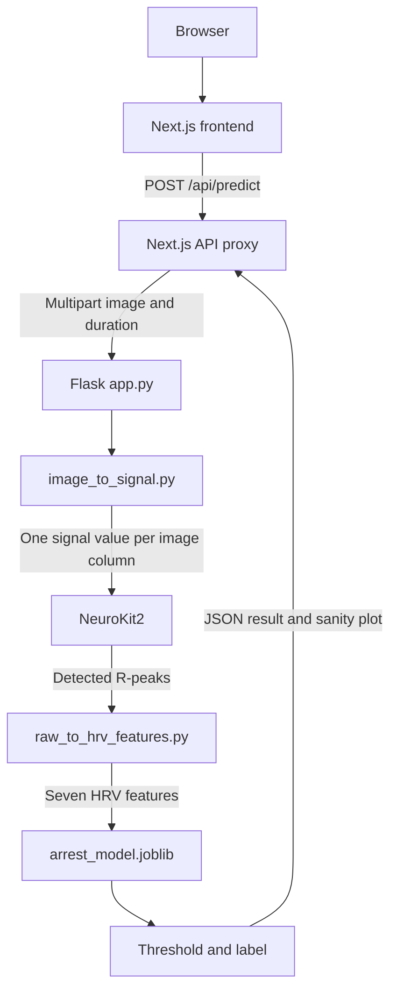

# Pre-Cardiac Arrest Prediction

ECG waveform image analysis with a Next.js frontend and Flask model API. This is a research and demonstration system, not a medical device; its output must not be used for diagnosis or emergency decisions.

## Current Model

The active model is `train/arrest_model.joblib`. It bundles a 300-tree balanced Random Forest, the seven HRV feature names, and the training threshold.

Features: `mean_rr`, `sdnn`, `rmssd`, `pnn50`, `sd1`, `sd2`, `sd1_sd2`.

| Metric | Result |
| --- | ---: |
| AUROC | 0.887 |
| Best training threshold | 0.490 |
| Accuracy | 0.844 |
| Sensitivity | 0.853 |
| Specificity | 0.833 |

These are results from the current grouped cross-validation run, not a guarantee for new recordings.

## How The Website Works



1. The user uploads a clean ECG plot and enters the duration represented by the image.
2. Next.js forwards the image to Flask at `http://127.0.0.1:5000/api/predict_image`.
3. `src/image_to_signal.py` digitizes the image into one numeric signal value per pixel column.
4. Flask derives the sampling rate as `image_width / duration_seconds` and checks that it is between 50 and 2,000 Hz.
5. NeuroKit2 cleans the signal and detects R-peaks.
6. `src/raw_to_hrv_features.py` calculates the seven RR-based HRV features. At least 150 beats are required.
7. The Random Forest produces a risk score. Flask returns `Normal` or `Pre-arrest`, the score, threshold, detected beat count, sampling rate, and a base64 sanity plot with detected peaks.

The runtime complements the artifact class-1 score for the website's calibrated display, so the displayed cutoff is `0.510` (`1 - 0.490`). The API and frontend use this same score and cutoff consistently.

## Repository Layout

```text
.
|-- app.py                          # Flask API and model runtime
|-- frontend/                       # Next.js website and API proxy
|-- src/
|   |-- image_to_signal.py          # ECG image digitizer
|   `-- raw_to_hrv_features.py      # Seven-feature HRV extraction
|-- train/
|   |-- train.py                    # Current training script
|   `-- arrest_model.joblib         # Active model artifact
|-- scripts/                        # Optional dataset extraction helpers
|-- static/                         # Static assets
|-- TestImages/                     # Local test images
|-- requirements.txt
`-- .gitignore
```

Generated training data, plots, frontend dependencies, build output, and deprecated `models/` artifacts are ignored by Git.

## Installation

From the repository root:

```bash
python3 -m venv venv
source venv/bin/activate
python -m pip install --upgrade pip
python -m pip install -r requirements.txt
```

Install frontend dependencies separately:

```bash
cd frontend
npm install
```

## Run The Website

Start Flask from the repository root:

```bash
source venv/bin/activate
python app.py
```

Start Next.js in another terminal:

```bash
cd frontend
npm run dev
```

Open [http://localhost:3000](http://localhost:3000). The frontend proxies image requests to Flask. Flask exposes a readiness check at [http://127.0.0.1:5000/health](http://127.0.0.1:5000/health).

At startup, Flask loads only `train/arrest_model.joblib`. No old scaler, feature-column, or separate threshold files are required.

## API Routes

| Route | Method | Purpose |
| --- | --- | --- |
| `/health` | `GET` | Reports model readiness, model name, and runtime threshold. |
| `/api/predict_image` | `POST` | Accepts multipart `ecg_image` and `duration_seconds`. |
| `/api/predict` | `POST` | Accepts JSON with exactly one of `r_peaks` or `ecg_signal`, plus `sampling_rate`. |

Example raw R-peak request:

```bash
curl -X POST http://127.0.0.1:5000/api/predict \
  -H 'Content-Type: application/json' \
  -d '{"sampling_rate":250,"r_peaks":[0,210,415,625,830]}'
```

## Retrain The Model

The current trainer creates five-minute NSRDB and SDDB windows, calculates the seven HRV features, evaluates the Random Forest with five-fold grouped cross-validation, chooses the Youden-J threshold, and saves the artifact:

```bash
cd train
python train.py
```

The script writes `arrest_model.joblib` and the generated `ecg_waveforms.png` in `train/`. The waveform plot is ignored by Git; the model artifact remains available to the application.

## Limitations

- The model predicts HRV patterns and does not diagnose cardiac arrest.
- Image digitization is heuristic and can be affected by gridlines, labels, legends, cropping, low contrast, or paper photographs.
- The supplied duration must accurately represent the waveform image.
- Short or irregular recordings may not contain the required 150 valid beats.
- The Flask development server is intended for local use, not production deployment.
